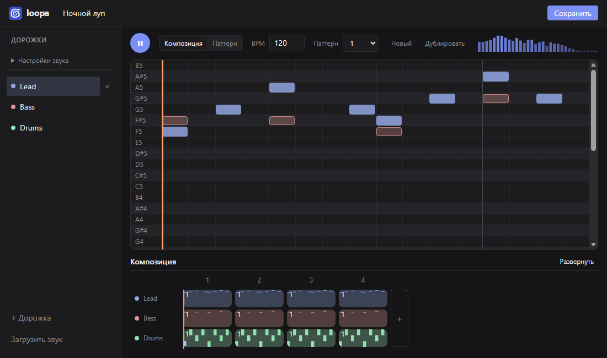

<h1 align="center">
  
</h1>

<p align="center">
  Браузерный музыкальный секвенсор для мелодий, битов и лупов.
</p>


<p align="center">
  
</p>

## Возможности

- **Редактируй ноты на сетке.** Добавляй, перемещай и растягивай ноты, выделяй их группами и отменяй изменения.
- **Собирай композицию из паттернов.** Раскладывай партии по тактам, задавай темп и свинг, следи за курсором и подсветкой звучащих нот.
- **Настраивай звук.** Используй синтезаторы и ударные или добавляй свои сэмплы в WAV и MP3. Управляй громкостью, задержкой и реверберацией по дорожкам.
- **Делись лупом.** Редактор доступен гостям. С аккаунтом можно сохранять проекты и отправлять публичные ссылки для прослушивания. Вошедший слушатель может сделать свою копию.

## Локальный запуск

Понадобятся **Node.js 24**, **Ruby 3.4** и **Bundler**. Если установлен `mise`, можно установить нужную версию Node.js командой `mise install` из корня репозитория.

**Первый запуск**

Из корня репозитория установи Foreman, зависимости клиента и сервера и подготовь базу данных.

```sh
gem install foreman
cd web
npm ci
cd ../api
bundle install
ruby bin/rails db:prepare
cd ..
```

**Запуск проекта**

```sh
foreman start -f Procfile.dev
```
